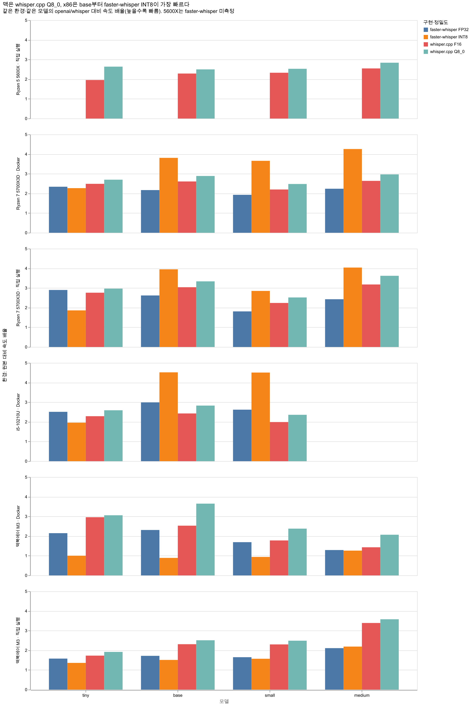
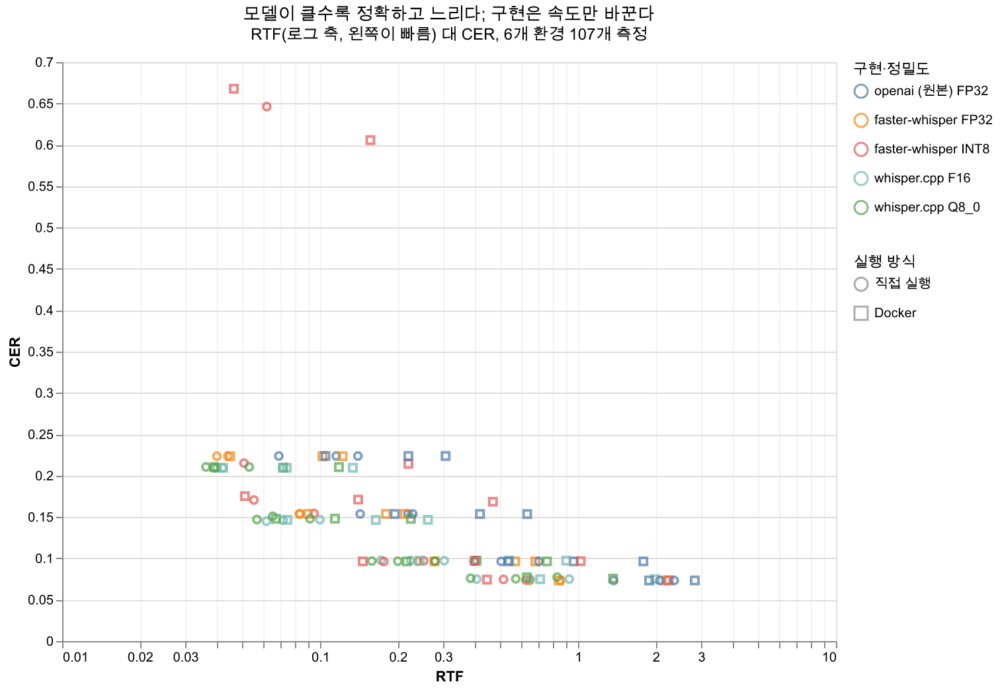
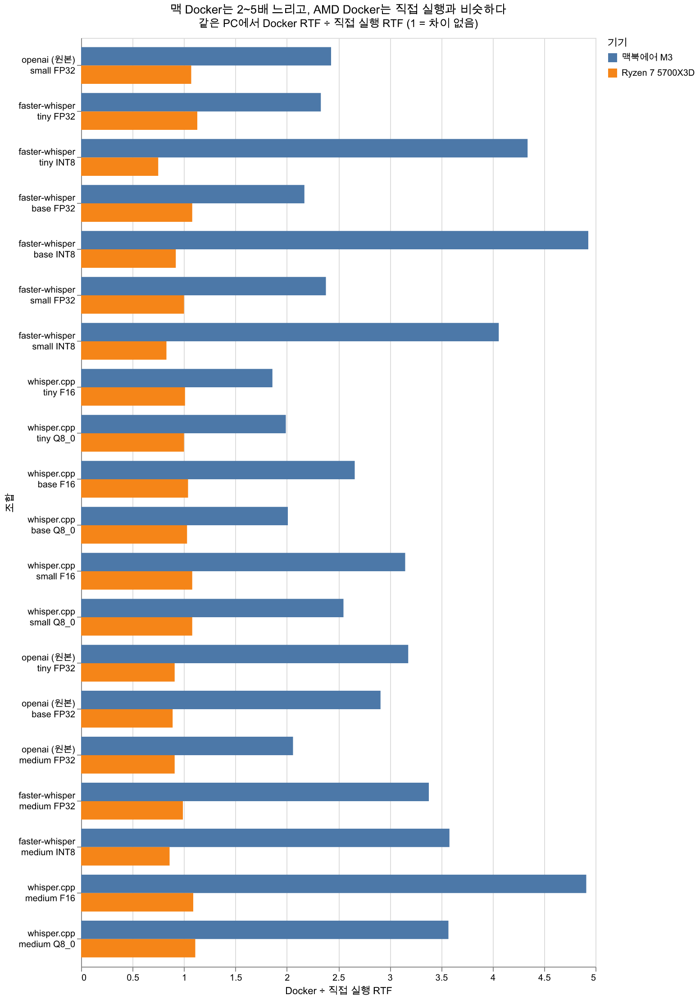

# WhisperLite Bench

외장 GPU가 없는 노트북에서 오픈소스 음성인식 모델 Whisper를 쓰려는 사람을 위해, 세 가지 실행 방식을 같은 조건에서 비교하고 **내 PC에 맞는 설정을 추천**하는 도구입니다.

| 실행기 | 역할 | 정밀도 |
|---|---|---|
| [openai/whisper](https://github.com/openai/whisper) | 기준선 (원본 재현) | FP32 |
| [faster-whisper](https://github.com/SYSTRAN/faster-whisper) | 경량화 ① (CTranslate2) | FP32, INT8 |
| [whisper.cpp](https://github.com/ggml-org/whisper.cpp) | 경량화 ② (C/C++) | F16, Q8_0 |

모델 크기 tiny, base, small, medium을 합쳐 20개 조합의 **속도(RTF)**, **한국어 정확도(CER)**, **최대 메모리**를 잽니다.

## 동작 방식

1. **사전 측정 (팀, Docker):** 공개 한국어 데이터 Zeroth-Korean 테스트셋 전체로 20개 조합을 측정해 CER 표를 만듭니다. Docker로 누구나 같은 소프트웨어 환경에서 재현할 수 있습니다.
2. **사용자 PC 측정 (직접 실행):** 사용자 PC에서 사용 가능한 메모리에 들어가는 조합만 골라 짧은 샘플로 속도와 메모리를 잽니다.
3. **추천:** 사전 측정한 CER과 내 PC의 측정값을 합쳐, 허용 오류율과 목표 속도를 만족하는 가장 빠른 조합을 고릅니다.
4. **검증:** 같은 PC에서 Docker와 직접 실행의 차이를 비교하고, 추천 결과가 전체 측정의 최적 조합과 일치하는지 확인합니다.

측정 규칙(디코딩 옵션 고정, CPU 전용, 로딩 시간 분리, CER 정규화)은 [docs/measurement-rules.md](docs/measurement-rules.md)에 있습니다.

## 결과

Zeroth-Korean 테스트셋 457문장(71.5분)을 기기 4대, 6개 환경에서 측정했습니다. 원본 CSV는 [results/](results/)에 있습니다. 5600X 결과만 아직 병합 전인 PR [#2](https://github.com/curydev/whisperlite-bench/pull/2)에 있습니다. 기기 정보는 [docs/devices.md](docs/devices.md)에 있습니다.

| 기기 | CPU | RAM | 환경 | 스레드 | 측정한 조합 |
|---|---|---|---|---|---|
| MacBook Air 13 (2024) | Apple M3 (ARM, 8코어) | 8GB | 직접 실행, Docker(Colima 6GB) | 8 | 20 + 20 |
| 자작 데스크톱 | AMD Ryzen 7 5700X3D (x86, 8코어) | 16GB | 직접 실행(Windows), Docker(WSL2 7.7GB) | 8 | 20 + 20 |
| 노트북 (DESKTOP-0111OH2) | Intel Core i5-10210U (x86, 4코어 8스레드) | 8GB | Docker | 4 | 15 (메모리 부족으로 medium 제외) |
| 데스크톱 (desktop-8afclth) | AMD Ryzen 5 5600X (x86, 6코어 12스레드) | 미기재 | 직접 실행(WSL2) | 6 | 12 (faster-whisper 8개는 설치 오류로 제외) |



### 검증 지표

**① 원본 대비 속도 향상.** 가장 빠른 경량 조합은 같은 환경의 openai/whisper보다 이만큼 빠릅니다.

| 환경 | tiny | base | small | medium |
|---|---|---|---|---|
| 맥 직접 실행 | 1.9배 (cpp Q8_0) | 2.5배 (cpp Q8_0) | 2.5배 (cpp Q8_0) | 3.6배 (cpp Q8_0) |
| 맥 Docker | 3.1배 (cpp Q8_0) | 3.6배 (cpp Q8_0) | 2.4배 (cpp Q8_0) | 2.1배 (cpp Q8_0) |
| 5700X3D 직접 실행 | 3.0배 (cpp Q8_0) | 4.0배 (faster INT8) | 2.9배 (faster INT8) | 4.0배 (faster INT8) |
| 5700X3D Docker | 2.7배 (cpp Q8_0) | 3.8배 (faster INT8) | 3.7배 (faster INT8) | 4.3배 (faster INT8) |
| i5-10210U Docker | 2.6배 (cpp Q8_0) | 4.5배 (faster INT8) | 4.5배 (faster INT8) | — |
| 5600X 직접 실행 | 2.6배 (cpp Q8_0) | 2.5배 (cpp Q8_0) | 2.5배 (cpp Q8_0) | 2.8배 (cpp Q8_0) |

5600X는 faster-whisper를 재지 못해 whisper.cpp끼리만 비교한 값입니다.

**② 원본 대비 CER 증가폭.** small과 medium에서는 모든 경량 조합이 원본보다 최대 0.4%p 높습니다. tiny와 base의 whisper.cpp는 원본보다 0.3~1.4%p 낮습니다. 예외는 두 가지입니다.
- faster-whisper base INT8은 1.5~2.2%p 높습니다. 맥 직접 실행만 0.1%p입니다.
- faster-whisper tiny INT8은 x86 세 환경(5700X3D 직접 실행·Docker, i5-10210U Docker)에서 CER이 0.61~0.67로 원본(0.22)보다 크게 나쁩니다. 457문장 중 139~142문장의 전사가 정답보다 3배 넘게 길어지기 때문입니다. 그중 123~125문장은 쉼표가 끝없이 이어지는 형태이고, `,000` 반복은 7~10문장뿐입니다. 맥에서는 0.21~0.22로 정상입니다.
- 같은 CPU(i5-10210U)를 쓰는 다른 노트북에서 Docker 없이 직접 실행한 50문장 측정(병합 전인 PR [#4](https://github.com/curydev/whisperlite-bench/pull/4))은 0.19로 정상이었습니다. 같은 50문장이 i5-10210U Docker에서는 0.45였습니다. 따라서 x86 CPU만으로는 설명되지 않습니다.

**③ 최대 메모리.** 양자화한 조합은 메모리를 크게 줄입니다. 5700X3D Docker의 medium을 예로 들면 다음과 같습니다(openai/whisper 4,664MB 기준).

| faster FP32 | faster INT8 | whisper.cpp F16 | whisper.cpp Q8_0 |
|---|---|---|---|
| 4,343MB (93%) | 1,542MB (33%) | 2,091MB (45%) | 1,408MB (30%) |

가장 많이 줄인 경우는 맥 Docker tiny의 whisper.cpp Q8_0로, 원본의 23%입니다. Linux와 Docker는 PSS로, macOS와 Windows 직접 실행은 RSS로 재므로 환경끼리 직접 비교하지는 마세요.

**④ 기기 간 경향.**
- **CPU 계열에 따라 가장 빠른 구현이 다릅니다.** 맥(ARM)에서는 모든 모델에서 whisper.cpp Q8_0이 가장 빠릅니다. x86 세 환경에서는 tiny만 whisper.cpp Q8_0이고, base부터는 faster-whisper INT8이 가장 빠릅니다.
- **맥 Docker의 faster-whisper INT8:** base와 small에서는 원본보다도 느립니다(0.9배).
- **같은 CPU 계열 안에서는 순서가 거의 같습니다.** 20개 조합의 RTF 순위 상관(Spearman)은 x86 환경끼리 0.97~0.99입니다. 맥과 x86 사이는 0.78~0.96입니다. 5600X는 openai와 whisper.cpp 12개 조합만 있어 순서 비교에서 뺐습니다.
- **같은 계열 CPU끼리는 속도만 다릅니다.** 5600X(6스레드)는 5700X3D 직접 실행(8스레드)보다 1.04~1.71배 느렸습니다. CER은 12개 조합 모두 0.3%p 안에서 같았습니다.
- **CER은 환경과 거의 무관합니다.** 같은 조합의 CER 차이는 0.5%p 이하입니다. 예외는 위의 faster-whisper INT8 두 조합입니다.



**⑤ 추천 적중.** 맥 Docker에서 50문장 짧은 측정으로 추천한 조합을, 457문장 전체 측정의 최적 조합과 비교했습니다. 허용 CER, 목표 RTF, 메모리 한도를 조합한 144가지 조건을 썼습니다([scripts/verify_recommend.py](scripts/verify_recommend.py)).

| RTF 안전 여유 | 일치 | 조건 위반 | 평균 손해 | 최대 손해 |
|---|---|---|---|---|
| 없음 | 70.9% | 14가지 | 1.08배 | 1.41배 |
| 5% | 76.5% | 6가지 | 1.08배 | 1.41배 |

손해 배율은 추천한 조합의 실제 RTF를 최적 조합의 RTF로 나눈 값입니다.
- **짧은 측정의 정확도:** 짧은 측정은 빠르기 순서를 잘 맞힙니다(순위 상관 0.98). 다만 RTF를 평균 9% 빠르게 잡습니다.
- **틀린 추천의 원인:** 대부분 faster-whisper small FP32 하나 때문입니다. 짧은 측정에서는 0.37~0.43인데, 전체 측정은 두 번 모두 0.55~0.57이었습니다.
- **다른 기기:** 아직 맥에서만 검증했습니다. 다른 기기는 50문장 짧은 측정이 들어오면 검증합니다.

**⑥ Docker와 직접 실행의 차이.** 같은 PC에서 Docker가 직접 실행보다 얼마나 느린지는 플랫폼에 따라 크게 다릅니다.
- **맥:** Docker가 1.9~4.9배 느립니다(중앙값 2.8배). Colima VM 안에서 돌고, whisper.cpp는 macOS의 Accelerate 가속을 쓰지 못합니다.
- **5700X3D:** Docker와 직접 실행의 RTF 비율이 0.75~1.13배(중앙값 1.0배)로 비슷합니다.
- **CER:** 두 기기 모두 환경을 바꿔도 거의 같습니다.



### 결론

- **ARM(맥):** whisper.cpp Q8_0을 쓰세요. 모든 크기에서 가장 빠르고 메모리도 가장 적게 씁니다.
- **x86:** tiny는 whisper.cpp Q8_0, base부터는 faster-whisper INT8을 쓰세요. faster-whisper tiny INT8은 x86 세 환경에서 반복 오류가 났으므로 피하세요. 정상으로 나온 x86 환경도 있어 원인은 아직 모릅니다.
- **정확도가 필요하면:** 한국어에서는 small(CER 약 9.7%)부터 쓸 만합니다. medium은 CER이 7.3~7.7%로 가장 낮고, 가장 빠른 조합의 RTF는 직접 실행 기준 0.38(맥)~0.51(5700X3D)입니다.
- **속도 측정 환경:** 맥에서는 Docker 측정값으로 실제 속도를 판단하지 마세요. 직접 실행에서 다시 재야 합니다.

### 한계

- **스레드 수:** i5-10210U는 4스레드, 5600X는 6스레드로 쟀고, 나머지는 8스레드입니다.
- **whisper.cpp 버전:** 기기마다 다릅니다. 맥은 `482279b8`, 5700X3D는 `f92e1e4d`입니다.
- **5600X의 faster-whisper:** PR [#2](https://github.com/curydev/whisperlite-bench/pull/2)에서 faster-whisper 8개 조합이 설치 오류(PyAV `metadata_errors`)로 실패했습니다. 여기서는 성공한 12개만 썼고, 다시 재면 갱신합니다.
- **faster-whisper tiny INT8 반복 오류의 원인:** 아직 찾지 못했습니다. i5-10210U를 쓰는 노트북 두 대 중 Docker로 잰 쪽은 무너지고 직접 실행으로 잰 쪽은 정상이었습니다. 5700X3D는 Windows 직접 실행에서도 무너졌습니다. 그래서 CPU 제조사나 Docker 여부만으로는 설명되지 않습니다. Docker 이미지는 패키지 버전을 고정하지 않으므로 환경마다 CTranslate2 버전이 다를 수 있습니다. 이를 확인하려면 각 환경의 패키지 버전 기록이 필요합니다.
- **CER 정규화:** 숫자 표기는 정규화하지 않습니다. 전사문을 저장해 두었으므로 규칙이 바뀌면 `whisperlite rescore`로 다시 계산할 수 있습니다.

그림은 [Flint Chart](https://microsoft.github.io/flint-chart/)로 만들었습니다.

## 현재 상태

- [x] 측정 파이프라인, CER·RTF 계산, 메모리 측정, 추천 로직, CLI
- [x] 단위 테스트 (Whisper 없이 가짜 실행기로 파이프라인 검증), GitHub Actions
- [x] 세 실행기를 실제 모델로 실행해 확인 (맥, Windows, WSL2, Docker)
- [x] 테스트셋 전체(457문장)로 기기 4대 측정, 같은 PC에서 Docker와 직접 실행 비교 (맥, 5700X3D)
- [x] 추천 검증 (맥 Docker)
- [ ] whisper.cpp 버전을 Dockerfile에 고정 (지금은 `master`)
- [ ] 다른 기기의 추천 검증 (50문장 짧은 측정 필요)
- [ ] `docs/repo-analysis.md` 작성 (실행기 담당)

## 설치

### A. Docker (사전 측정, 재현용)

```bash
docker build -f docker/Dockerfile -t whisperlite .
```

```bash
docker run --rm -e WHISPERLITE_HOST="$(hostname -s)" -v "$PWD/data:/app/data" -v "$PWD/results:/app/results" -v whisperlite-cache:/cache whisperlite sysinfo
```

아래 사용법의 `whisperlite ...` 명령은 컨테이너에서는 위 명령의 `sysinfo` 자리에 넣어 실행합니다. `WHISPERLITE_HOST`는 결과 파일에 실제 PC 이름을 남기기 위한 값입니다(컨테이너 안의 호스트 이름은 매번 바뀜).

macOS·Windows의 Docker는 VM 안에서 돌아가므로 VM에 메모리를 충분히(medium까지 재려면 6GB 이상 권장) 할당하세요. Docker Desktop 대신 [Colima](https://github.com/abiosoft/colima)도 쓸 수 있습니다.

```bash
brew install colima docker docker-buildx && colima start --cpu 8 --memory 6
```

### B. 직접 실행 (Ubuntu 기본)

```bash
sudo apt install ffmpeg python3-venv cmake build-essential
```

```bash
python3 -m venv .venv && . .venv/bin/activate && pip install -e ".[faster,data,dev]"
```

whisper.cpp는 소스에서 빌드하고 `whisper-cli`를 PATH에 두거나 `WHISPER_CPP_BIN`으로 경로를 지정합니다.

```bash
git clone https://github.com/ggml-org/whisper.cpp && cmake -S whisper.cpp -B whisper.cpp/build && cmake --build whisper.cpp/build -j --config Release
```

```bash
export WHISPER_CPP_BIN="$PWD/whisper.cpp/build/bin/whisper-cli"
```

openai/whisper까지 직접 실행하려면 `pip install -e ".[openai]"`를 추가합니다 (PyTorch 설치로 용량이 큽니다). macOS·Windows 직접 실행은 확장 기능으로, 동작이 확인되면 여기에 추가합니다.

## 사용법

```bash
whisperlite prepare-data --out data/zeroth_test
```

```bash
whisperlite prepare-data --out data/sample --limit 20 --stride 20
```

```bash
whisperlite bench --manifest data/zeroth_test/manifest.csv
```

```bash
whisperlite recommend --reference results/reference.csv --max-cer 0.15 --max-rtf 0.5
```

```bash
whisperlite compare results/bench_mypc.csv results/bench_mypc_docker.csv
```

```bash
whisperlite plot results/reference.csv --out results/rtf_cer.png
```

- `prepare-data`: Zeroth-Korean 테스트셋(457개, 약 1.2시간)을 16kHz WAV와 `manifest.csv`로 준비합니다. `--limit`으로 일부만 받아 내장 샘플로 씁니다. 테스트셋이 화자 순서로 정렬되어 있으므로 `--stride`로 k개마다 하나씩 골라 여러 화자가 섞이게 하세요.
- `bench`: 20개 조합 전체 측정. 결과 파일에 이미 있는 조합은 건너뛰므로 중간에 멈춰도 이어서 돌릴 수 있습니다. 개발 중에는 `--runners faster --models tiny`처럼 좁혀서 돌리세요.
- `recommend`: 이 PC에서 후보를 짧게 재고 추천합니다. `--max-rtf 0.5`는 "음성 길이의 절반 시간 안에 처리"라는 뜻입니다.
- `compare`: 같은 PC에서 잰 두 결과(예: 직접 실행 vs Docker)의 RTF 비율과 메모리 차이.

결과 CSV 형식은 [results/README.md](results/README.md)를 보세요.

## 저장소 구조

```text
├── src/whisperlite/
│   ├── cli.py            명령어
│   ├── configs.py        측정 조합(20개)과 공통 디코딩 옵션
│   ├── data.py           데이터셋 → WAV + manifest
│   ├── worker.py         조합 하나를 별도 프로세스에서 실행
│   ├── measure.py        RTF·CER·최대 메모리 측정
│   ├── recommend.py      추천 로직
│   ├── sysinfo.py        CPU·RAM·Docker 메모리 제한
│   ├── textnorm.py       CER 정규화
│   └── runners/          실행기별 어댑터 (openai, faster, whispercpp)
├── tests/                단위 테스트
├── docker/Dockerfile     사전 측정용 Ubuntu 22.04 환경
├── docs/                 측정 규칙, 저장소 구조 분석, 기기 목록, 문제 해결 기록
└── results/              측정 결과 CSV와 그래프
```

## 역할 분담

| 담당 | 파일 |
|---|---|
| openai/whisper | `runners/openai_whisper.py`, `docs/repo-analysis.md` 해당 절 |
| faster-whisper | `runners/faster_whisper.py`, `docs/repo-analysis.md` 해당 절 |
| whisper.cpp | `runners/whisper_cpp.py`, `docker/Dockerfile`의 빌드, `docs/repo-analysis.md` 해당 절 |
| 측정·추천 | `measure.py`, `recommend.py`, `textnorm.py`, `cli.py` |

작업은 이슈로 만들고 브랜치에서 PR로 합칩니다. 오류는 "설치·실행 오류" 이슈 템플릿으로 기록합니다.

## 라이선스와 출처

- 이 저장소의 코드: MIT ([LICENSE](LICENSE))
- openai/whisper (MIT), faster-whisper (MIT), CTranslate2 (MIT), whisper.cpp (MIT), jiwer (Apache-2.0)
- 데이터: [Zeroth-Korean Speech Corpus (OpenSLR SLR40)](https://www.openslr.org/40/), CC BY 4.0. Hugging Face의 [`kresnik/zeroth_korean`](https://huggingface.co/datasets/kresnik/zeroth_korean)으로 받습니다. 데이터와 모델 파일은 저장소에 포함하지 않습니다.
- A. Radford et al., "Robust Speech Recognition via Large-Scale Weak Supervision," ICML 2023.
